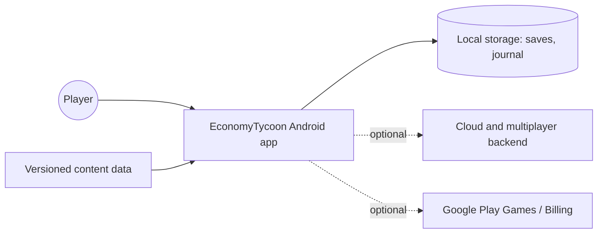
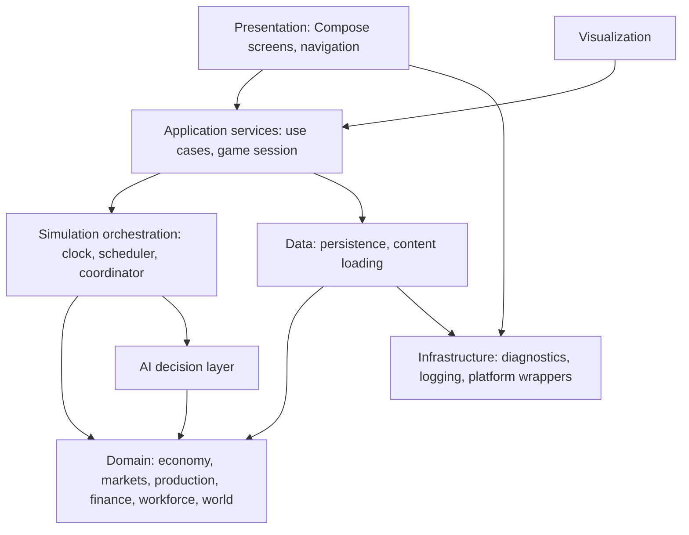

# Architecture Overview

## System context

Single-player works with no network. Backend and platform services are optional and isolated behind interfaces.

## Layers

| Layer | Responsibility | Depends on | Must not depend on |
|---|---|---|---|
| Presentation | Screens, state holders, navigation | Application services, design system | Domain internals, persistence |
| Visualization | Map and factory rendering from snapshots | Application services (read models) | Mutable simulation state |
| Application services | Use cases, session lifecycle, command submission, read models | Simulation orchestration, data | Compose, Android UI types |
| Simulation orchestration | Clock, scheduler, tick lifecycle, event queue, snapshots | Domain, AI | Android, persistence implementations |
| Domain | Economic rules and entities | Core primitives only | Anything Android, orchestration, data |
| AI decision | Agents that read observations and emit commands | Domain read interfaces | Direct state mutation |
| Data | Room, snapshot and journal storage, content loading | Domain types, infrastructure | Presentation |
| Infrastructure | Logging, diagnostics, dispatchers, time | Nothing in the game | Game layers |

Dependency direction is strictly downward. Dependencies upward are expressed as interfaces owned by the lower layer and implemented above (dependency inversion).

## Principles

1. The simulation is the single source of truth; UI renders projections.
2. All state changes occur through commands and rules inside a tick. No hidden mutation.
3. Players and AI use the same command interface and constraints.
4. Value is conserved: every transfer has a source, a destination and a ledger entry.
5. Determinism over convenience: fixed-point, seeded random, stable iteration order.
6. Data-driven content: industries, goods and recipes are data, not code.
7. Explicit contracts between modules; no reaching into another module's internals.
8. Every module is testable on the plain JVM.
9. Simple first; add complexity only when a measured need appears.
10. Cached projections are always rebuildable from authoritative state.

## Concurrency model

- One simulation thread owns mutable simulation state.
- UI and visualization read immutable snapshots published by the simulation.
- Persistence and AI planning that is read-only run on worker dispatchers against snapshots; their results re-enter the simulation as commands at tick boundaries.
- Parallel work inside a tick is allowed only over disjoint partitions with results merged in a defined order (see SIMULATION_ENGINE.md).

## Error handling

- Rule violations from commands return typed rejections; they do not throw.
- Invariant violations in the simulation are defects: debug builds fail fast, release builds quarantine the offending entity, log diagnostics and continue.
- Persistence failures never corrupt the live session; saves are written atomically.
