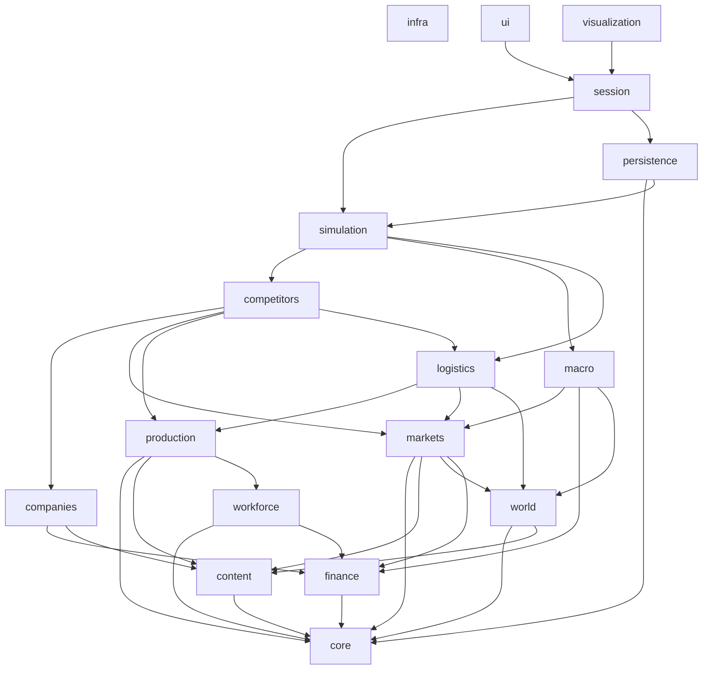

# Dependency Graph

Rules: arrows point to allowed dependencies; no cycles; `infra` is usable by anyone and depends on nothing. Where this graph and MODULE_CATALOG.md differ, MODULE_CATALOG.md and the architecture manifest win and this file must be corrected.

Note: `persistence` depends on `simulation` only through snapshot and state contracts defined in `core`/domain types; it must not call orchestration code.
